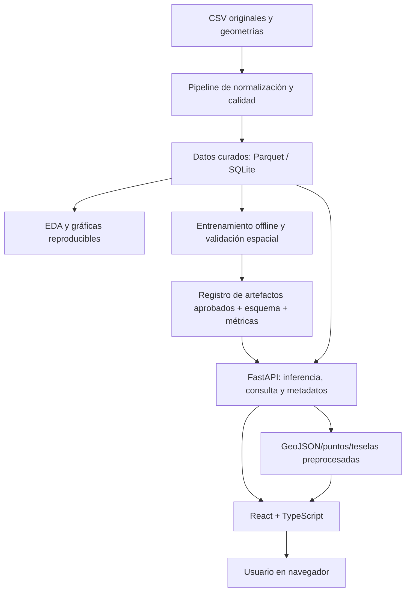

# GUÍA MAESTRA DE IMPLEMENTACIÓN — SISTEMA PREDICTIVO DEL VALOR DEL SUELO RURAL EN YACOPÍ

**Documento único de traspaso para un agente de IA programador.**  
**Edición:** 1.0 · **Fecha:** 14 de octubre de 2026 · **Idioma del producto y la documentación:** español (Colombia).  
**Estado:** diseño y diagnóstico de datos iniciado; **sin modelo entrenado ni software final implementado**.

> **INSTRUCCIÓN PRINCIPAL PARA EL AGENTE QUE RECIBA ESTE ARCHIVO**  
> Actúa como ingeniero de software senior, ingeniero de datos, especialista en ML y arquitecto de soluciones. Implementa, paso a paso, el proyecto que se describe aquí, con código ejecutable, pruebas automatizadas, documentación y decisiones trazables. Este documento contiene requisitos del anteproyecto, observaciones del antecedente académico, datos **ya inspeccionados** y decisiones técnicas **propuestas**. No confundas esos niveles. **No inventes etiquetas, entrenamiento, métricas, mapas, archivos, resultados o cumplimiento de tareas**. La elección y validación de una variable objetivo que represente **el valor exclusivo del terreno en COP/ha** es el principal pendiente científico. Puedes desarrollar todo lo que no dependa de ella, pero no publicar un “modelo validado” hasta resolverlo. Trabaja en iteraciones cortas y deja el repositorio ejecutable al término de cada una.

---

## 0. Cómo interpretar esta guía y tomar decisiones

**Leyenda de procedencia:**

- **[A — ANTEPROYECTO]**: obligación o enfoque que consta en `ANTEPROYECTO ARTICULO JULIAN Y VALENTINA.docx` (19 páginas). Debe respetarse o justificarse formalmente cualquier cambio.
- **[J — ANTECEDENTE]**: descripción, cifra o resultado comunicado en `PROYECTO REALIZADO POR JESUS.pdf` (14 diapositivas), **no reproducido** con nuestros CSV.
- **[D — DATOS AUDITADOS]**: comprobación realizada sobre los dos CSV recibidos y documentada en `proyecto_yacopi_datos/07_informe_calidad.md` y `06_resumen_diagnostico.json`.
- **[P — PROPUESTA TÉCNICA]**: arquitectura, algoritmo, estructura, interfaz, protocolo, controles, criterios y plan sugeridos para implementar lo exigido por el anteproyecto. No son citas literales de este.
- **[B — BLOQUEANTE]**: información aún no validada; **no** se soluciona asumiendo o rellenando valores.

**Reglas innegociables del agente:**

1. Inspecciona el repositorio y los insumos reales antes de alterar nada. Nunca sobreescribas los CSV originales. No descartes registros por intuición.
2. Prioriza reproducibilidad, trazabilidad de las transformaciones, separación entrenamiento/validación/prueba y prevención de *data leakage*.
3. No incluyas identificadores personales, matrículas, coordenadas sensibles, datos catastrales no autorizados ni archivos brutos en un repositorio público. Antes de publicar, revisar licencia y autorización del uso/divulgación.
4. Mantén **dos modos explícitos**: `ANALISIS_SIN_MODELO` (navegación y estadísticas descriptivas reales, sin predicción) y `PREDICCION_VALIDADA` (solo tras entrenar y aprobar un modelo con una etiqueta comprobada). Un modo `DEMO` opcional debe tener marca visible permanente y jamás mezclarse con datos científicos.
5. Un resultado del modelo deberá denominarse **“estimación académica de apoyo”**, no “avalúo oficial”, e indicar `COP/ha`. No atribuirle incertidumbre cuantificada si no fue evaluada.
6. No se permite filtrar al modelo columnas equivalentes a la respuesta mediante un código geoeconómico, un precio zonal conocido u otra variable construida a partir de la misma valoración objetivo.
7. Cuando falte una fuente técnica o decisión, crea un registro `docs/pendientes.md` con impacto, responsable y criterio de resolución; continúa con tareas independientes.
8. Agrega pruebas de cada módulo; cuando cambien esquemas, actualiza documentación, migraciones y contratos tipados.
9. Para un cambio grande: explica brevemente qué harás, implementa y prueba; reporta archivos cambiados, comandos ejecutados y resultados **reales**. No declares completada una fase sin ejecutar su criterio de aceptación.
10. Si se aporta nueva información del director del proyecto, actualiza el diccionario, la estrategia de objetivo y el registro de decisiones antes de entrenar.

---

## 1. Identidad, finalidad y fuentes del proyecto

### 1.1 Título y objetivo general [A]

**Título:** *Implementación de un software predictivo para estimar el valor del suelo rural: caso de estudio Yacopí, Cundinamarca*.

Proyecto de grado de **Ingeniería de Sistemas y Computación**, presentado en la modalidad **artículo**. Investigadores: Yeimy Valentina Sánchez Leguizamón y Nelson Julián Amaya García; director disciplinar Jesús Antonio Villarraga Palomino. El anteproyecto se radicó con fecha prevista del **1 de septiembre de 2026**. No incluir información de identificación o contacto personal de los autores en archivos técnicos innecesarios.

**Objetivo general según el anteproyecto:** desarrollar un software predictivo para estimar el valor del suelo rural a través de aprendizaje supervisado, a partir de atributos catastrales, físicos y territoriales reales de Yacopí, integrándolo en un prototipo para consulta y visualización.

### 1.2 Tres objetivos específicos [A]

1. Caracterizar variables catastrales, físicas y territoriales mediante análisis exploratorio, depuración inicial y estudio de su relación con el valor del suelo rural.
2. Comparar modelos supervisados mediante métricas, validación e interpretabilidad.
3. Implementar un prototipo con **backend FastAPI** y **frontend React** que integre el modelo seleccionado, búsqueda de predios, estimaciones, gráficas, mapas y métricas.

### 1.3 Necesidad, alcance y restricciones [A]

- Problema: rezagos catastrales, heterogeneidad territorial, dificultades para construir valoraciones consistentes y consultables.
- Unidad de análisis: **predio rural**, no fila de intersección geoeconómica.
- Ámbito territorial: **municipio de Yacopí, Cundinamarca, Colombia**.
- El producto es un **prototipo académico funcional**. No sustituye peritos, estudios de mercado, gestión catastral oficial ni avalúo individual.
- Un buen resultado incluye tanto comparación de modelos y documentación científica como un software usable. Una tabla de métricas o una interfaz estática no satisfacen por sí solas el anteproyecto.

### 1.4 Metodología y stack definidos por el anteproyecto [A]

- **CRISP-DM:** comprensión del problema, comprensión de datos, preparación, modelado, evaluación y puesta en uso de resultados.
- **Enfoque ágil tipo Scrum:** iteraciones para arquitectura, implementación, integración, pruebas y documentación.
- **Lenguajes:** Python 3.13 o superior y JavaScript/TypeScript.
- **Procesamiento:** pandas, NumPy y GeoPandas.
- **Modelado:** scikit-learn y modelos supervisados apropiados (regresión regularizada, árboles, bosques y ensambles). Se puede añadir CatBoost por el antecedente [J].
- **API:** FastAPI, Pydantic, Uvicorn.
- **Cliente:** React con Vite.
- **Visualización:** Plotly, Leaflet/Folium o bibliotecas compatibles.
- **Persistencia:** CSV/Parquet, SQLite o GeoPackage, según etapa.
- **Entrega y reproducibilidad:** Git, dependencias fijadas y Docker.
- Las versiones exactas de cada paquete deberán verificarse por compatibilidad en el entorno real y fijarse en un lockfile. **No afirmar que una combinación funciona antes de instalarla y probarla.**

### 1.5 Entregables comprometidos [A]

1. Base de datos depurada, estructurada y documentada.
2. Modelos comparados; modelo elegido, entrenado, evaluado, serializado, con esquema de variables y ficha técnica.
3. Prototipo web **React + FastAPI** con consulta, predicción, mapas, gráficos y métricas reales.
4. Artículo científico con metodología, experimentos, resultados y discusión.
5. Presentación, manual de ejecución, pruebas y documentación técnica de sustentación.

### 1.6 Marco y prudencia normativa [A]

El anteproyecto cita el **artículo 49 de la Ley 2294 de 2023**, la **Resolución IGAC 1040 de 2023**, la **Resolución 746 de 2024** y la **Resolución Conjunta 1456 de 2024** (LADM_COL 4.1), además de otras fuentes. Trátalas como referencias **incluidas en el anteproyecto**, no como un dictamen de vigencia actualizado; si el artículo requiere citar normativa vigente en la fecha final, corroborar los textos oficiales por separado.

---

## 2. Antecedente de Jesús: lo que enseña y lo que NO demuestra para nuestro proyecto

**Fuente [J]:** `PROYECTO REALIZADO POR JESUS.pdf`, 14 diapositivas, *Modelo estadístico-predictivo para la valoración del suelo rural en el municipio de Yacopí (COP/ha)*, Jesús Antonio Villarraga P.

### 2.1 Solución previa

- Método CRISP-DM; modelo de **regresión supervisada CatBoost**.
- Variable señalada: `VALOR_TERRENO_Ha` (**COP/ha**).
- Variables físicas, catastrales, territoriales, de uso y accesibilidad.
- El modelado reconoce relaciones no lineales y heterogeneidad del territorio.
- Sus predicciones se presentan como apoyo para focalizar revisión técnica, no como avalúo oficial.

### 2.2 Hallazgos que deben orientar nuestro EDA, no reemplazarlo

| Diapositiva | Hallazgo o figura reportada por el autor | Implicación sugerida [P] |
|---|---|---|
| 1 y 6 | Mapas de valor del terreno por hectárea; agrupación espacial de valores. | Analizar autocorrelación y evaluar particiones espaciales. |
| 6 | Aproximadamente 20 % de predios representaría 52 % del valor catastral y 17 % del área. | Evitar que métricas agregadas oculten segmentos extremos; verificar en nuestros datos. |
| 6 | Franja nororiental con valores mayores. | Evaluar error por territorio, nunca dar por hecho que la misma pauta persiste. |
| 7 | Mediana habitacional ≈ 10,96 millones COP/ha frente a agropecuario ≈ 480 mil COP/ha; 4.865 predios agropecuarios en **la muestra de Jesús**. | Considerar heterogeneidad por destino; estas cantidades no corresponden a los dos CSV actuales. |
| 7 | `ZHF_INFLUE = 3` ≈ 964.000 COP/ha de mediana; sendero `=8` ≈ 385.380; referencia sin vía ≈ 312.473. | Examinar accesibilidad; solicitar diccionario de categorías para codificar correctamente. |
| 8 | Sin restricciones agropecuarias: 3.463 predios, mediana ≈ 481.750 COP/ha **en el antecedente**. | Estudiar `UPS`/usos con los datos actuales. |
| 8 | Predios pequeños, especialmente menores de 10 ha, presentan algunos valores altos por hectárea; predios grandes tienden a valores unitarios menores. | Medir valor por rangos de superficie, sin inferir causalidad. |
| 9 | Esquema conceptual CatBoost y función de predicción. | Incluirlo entre modelos candidatos. |
| 10 | Gráfico predicho vs. observado y tabla de errores. | Implementar comparaciones con ejes y unidades claros. |
| 11 | Mapa con clases espaciales de error relativo. | Construir mapas de error solamente sobre casos etiquetados y evaluados. |
| 12 | Importancia SHAP global y explicación local de una predicción. | Añadir interpretabilidad en el modelo final si se puede calcular de manera correcta. |

### 2.3 Métricas publicadas en el antecedente [J]

| Métrica | Valor mostrado |
|---|---:|
| MAE | 1.049.341,89 COP/ha (según objetivo de la presentación) |
| RMSE | ≈ 16.033.970,5 COP/ha (lectura del PDF; presenta puntuación ambigua) |
| MAPE | 63,07 % |
| R² | 0,3025 |
| RMEDSE | 93.136,47 |
| MdAPE | 20,58 % |
| RMSLE | 0,5749 |
| Predicciones con error inferior a 30 % | **61,68 %** en diapositivas 10 y 13; **67,46 %** en diapositivas 11 y 13 |
| Predicciones con error no superior a 20 % | 53,84 % en diapositiva 11 |

**Inconsistencia interna explícita:** la presentación ofrece simultáneamente **61,68 % y 67,46 %** como tasa de error <30 %. **No corregirla por conjetura**; atribuir cada valor a la diapositiva correspondiente hasta contar con código y resultados originales. Las cifras de Jesús **no son objetivos mínimos, umbrales aprobados ni métricas de nuestro modelo nuevo**. El nuevo artículo presentará exclusivamente nuestros resultados ejecutados.

### 2.4 Diferencia fundamental

Jesús presentó un **modelo y su análisis estadístico**. Este proyecto debe ir más allá: crear un **software completo**, comparar modelos con evidencia reproducible, diseñar una API, desarrollar una interfaz, integrar datos, documentar y probar el producto. No es un clon de sus diapositivas ni contamos con su artefacto `.cbm` o código fuente.

---

## 3. Archivos existentes, inventario y estado REAL

### 3.1 Insumos originales aportados

1. `ANTEPROYECTO ARTICULO JULIAN Y VALENTINA.docx`: definición de trabajo, objetivos, metodología, tecnología, entregables.
2. `PROYECTO REALIZADO POR JESUS.pdf`: antecedente científico, resultados y gráficas.
3. `interseccion_terrenos_zhg_r1_yacopi.csv`: **9.447 filas**, 17 columnas, varias intersecciones por predio.
4. `zhf_yacopi (1).csv`: **7.968 filas**, 28 columnas, atributos físicos/geográficos.
5. `Modelo_valoracion_suelo_rural_Yacopi.md`: transcripción del antecedente con explicaciones de gráficas; sus referencias a imágenes pueden requerir archivos adjuntos.

### 3.2 Archivos PREPARADOS EN UNA FASE ANTERIOR [D]

Estos están disponibles en `proyecto_yacopi_datos/` y pueden obtenerse también del paquete `YACOPI_DATOS_PREPARADOS_Y_DIAGNOSTICO.zip`. **Es obligatorio proporcionar los archivos de datos al agente para ejecutar ML; este `.md` no incorpora el contenido íntegro de millones de celdas.**

| Archivo | Qué contiene | Cómo usarlo |
|---|---|---|
| `01_intersecciones_normalizadas.csv` | Todos los registros originales con formatos de códigos normalizados; geometrías preservadas | Auditoría y reconstrucción del cruce. |
| `02_zhf_normalizadas.csv` | Todos los registros originales ZHF, con geometrías preservadas | Auditoría y atributos geográficos. |
| `03_predios_consolidados.csv` | **7.709 predios únicos** de la primera fuente, 49 columnas | Tabla analítica inicial **no final**. |
| `04_predios_solo_zhf.csv` | 227 predios sin coincidencia en la primera fuente | Evaluar cobertura, sin inventarles precios. |
| `05_banderas_calidad.csv` | Alertas de calidad por predio | Filtrar/visualizar inconsistencias, no eliminar ciegamente. |
| `06_resumen_diagnostico.json` | Conteos reproducibles | Auditoría y pruebas de regresión de datos. |
| `07_informe_calidad.md` | Explicación metodológica y alertas | Leer obligatoriamente antes de modelar. |
| `08_variables_candidatas_sin_etiqueta.csv` | Tabla de entradas candidatas **sin objetivo ni precios zonales** | Semilla del contrato de características; no todas están aprobadas. |
| `09_referencias_valor_no_validadas_como_etiquetas.csv` | Avalúo y referencias de precio separadas expresamente | Solo análisis y discusión de etiqueta, **no usar automáticamente como `y`**. |
| `preparar_datos.py` | Script de normalización, cruce y auditoría | Reproducir transformaciones con CSV originales. |
| `crear_resumen_graficas.py` | Script de gráficos descriptivos | Generar EDA sin pretender entrenamiento. |
| `grafica_01_*.png`…`grafica_04_*.png` | Figuras exploratorias | Referencia visual, no resultados predictivos. |

### 3.3 Conteos de auditoría comprobados [D]

| Medida | Resultado |
|---|---:|
| Filas intersecciones ZHG | 9.447 |
| Filas ZHF | 7.968 |
| Predios únicos en intersecciones | 7.709 |
| Predios únicos en ZHF | 7.921 |
| Predios emparejados por ID | 7.694 |
| Predios solo intersecciones | 15 |
| Predios solo ZHF | 227 |
| Predios con múltiples intersecciones ZHG | 1.601 |
| Filas duplicadas idénticas sobrantes intersecciones | 3 |
| Filas sobrantes por códigos `CODPRED` repetidos ZHF | 47 |
| Predios con superficie construida positiva | 3.033 |
| Diferencia ZHF vs área catastral >5 %, entre coincidentes | 4.924 |
| Suma de áreas de intersecciones vs ZHF dentro del 1 % | 7.548 |
| Diferencia entre áreas geométricas >5 % | 106 |
| Zona ZHG dominante no coincide con ZHG declarada en ZHF | 843 |

**Lectura:** un mismo predio aparece repetido cuando intersecta varias zonas. El error sería cruzar las tablas directamente fila a fila, duplicando predios. Las diferencias de área son **alertas**, no evidencias automáticas de que una fuente esté mal. Las 47 filas excedentes en ZHF no tenían diferencias en los atributos tabulares auditados, lo cual no descarta diferencias geométricas.

### 3.4 Columnas originales: primera fuente [D]

`departamento`, `municipio`, `numero_predial_anterior`, `numero_predial`, `codigo_orip`, `matricula_inmobiliaria`, `codigo_lote`, `destino_economico`, `valor_avaluo`, `area_terreno_m2`, `area_en_zonageoeconomica_m2`, `porcentaje_en_zonageo_respecto_suma`, `area_construida_m2`, `codigo_zona_geoeconomica`, `valor_hectarea_agropecuario`, `geometria_interseccion`, `geometria`.

Claves interpretativas:

- `numero_predial`: **identificador textual**, no variable predictora numérica.
- `area_terreno_m2`: superficie catastral en m²; su discrepancia con superficies geométricas requiere investigar definiciones/fechas.
- `area_en_zonageoeconomica_m2`: área de la porción intersectada, no necesariamente área completa del predio.
- `porcentaje_en_zonageo_respecto_suma`: participación en intersecciones, suma esperada 100 % por predio.
- `valor_avaluo`: avalúo catastral de alcance aún incierto (podría incluir construcciones).
- `valor_hectarea_agropecuario`: referencia de precio asignada a la zona, no una tasación independiente demostrada del predio.
- `geometria_interseccion`, `geometria`: posibles EWKB; revisar origen y consistencia de SRID.

### 3.5 Columnas originales: segunda fuente [D]

`id`, `geom`, `CODPRED`, `AREA_TERRE`, `TR_LATITUD`, `TR_LONGITU`, `TR_ESTE`, `TR_NORTE`, `ZHF_CODIGO`, `ZHF_DISPON`, `ZHF_INFLUE`, `ZHF_USO_AC`, `SINAP_NOMB`, `SINAP_CATE`, `AHT_VPOTEN`, `FA_ELEMENT`, `VUS_VOCACI`, `UPS`, `ZHG_CODIGO`, `ZHG_VALOR_`, `ZHG_VALOR1`, `ZHG_SUBZON`, `CLC_NIVEL1`, `CLC_NIVEL2`, `CLC_NIVEL3`, `CLC_NIVEL4`, `CLC_NIVEL5`, `CLC_NIVEL6`.

- **Llave de unión:** `numero_predial` = `CODPRED` (tratadas como cadenas, respetando ceros).
- `AREA_TERRE`: área geográfica de definición/fecha aún por confirmar.
- `TR_LATITUD`, `TR_LONGITU`: coordenadas geográficas para cartografía de **puntos**, sujetas a verificar origen y exactitud.
- `ZHF_*`, `VUS_VOCACI`, `UPS`, `CLC_NIVEL*`, `SINAP_*`: posibles variables explicativas (ver diccionario oficial).
- `ZHG_CODIGO`, `ZHG_VALOR_`, `ZHG_VALOR1`: elementos **geoeconómicos** con riesgo de fuga del objetivo; mantener excluidos por defecto.
- `geom`: geometría GIS; no cargar como texto WKB en cada consulta de predicción.

### 3.6 Tabla consolidada: nombres efectivamente producidos [D]

`numero_predial`, `numero_predial_anterior`, `departamento`, `municipio`, `codigo_orip`, `matricula_inmobiliaria`, `codigo_lote`, `destino_economico`, `valor_avaluo_total_cop`, `area_terreno_catastral_m2`, `area_construida_m2`, `referencia_avaluo_total_por_ha_cop`, `cantidad_intersecciones`, `cantidad_zonas_zhg`, `zhg_codigo_predominante`, `zhg_porcentaje_predominante`, `referencia_zhg_valor_predominante_cop_ha`, `referencia_zhg_valor_ponderado_cop_ha`, `suma_porcentaje_intersecciones`, `suma_area_intersecciones_m2`, `razon_area_intersecciones_catastral`, `coincide_zhf`, `registros_zhf_mismo_predio`, `id_zhf_primera_fila`, `area_zhf_m2`, `razon_area_zhf_catastral`, `razon_area_geo_zhg_zhf`, `tr_latitud`, `tr_longitud`, `tr_este`, `tr_norte`, `zhf_codigo`, `zhf_dispon`, `zhf_influe`, `zhf_uso_ac`, `aht_vpoten`, `fa_element`, `vus_vocaci`, `ups`, `zhg_codigo_zhf`, `referencia_zhg_valor_zhf_cop_ha`, `referencia_zhg_valor1_zhf_cop_ha`, `zhg_subzona`, `clc_nivel1`, `clc_nivel2`, `clc_nivel3`, `clc_nivel4`, `clc_nivel5`, `clc_nivel6`.

Las 49 columnas pueden incluir valores útiles para la consulta pero **no equivalen a 49 entradas del modelo**. Cada columna debe registrarse como `id`, `característica`, `referencia económica`, `resultado`, `auditoría` o `metadato`. El consolidado anterior **no conserva por sí solo las geometrías**; obténlas de las fuentes normalizadas si la aplicación necesita polígonos.

### 3.7 Características candidatas ya aisladas [D]

`08_variables_candidatas_sin_etiqueta.csv` incluye:

`numero_predial` (solo llave), `area_terreno_catastral_m2`, `area_zhf_m2`, `area_construida_m2`, `destino_economico`, `tr_latitud`, `tr_longitud`, `zhf_codigo`, `zhf_dispon`, `zhf_influe`, `zhf_uso_ac`, `aht_vpoten`, `vus_vocaci`, `ups`, `clc_nivel1` a `clc_nivel6`.

**Candidatas, no selección definitiva.** Hay que revisar disponibilidad de cada atributo en tiempo de inferencia, relación con etiqueta, licitud, estabilidad, correlación entre campos y posibles dependencias geográficas.

### 3.8 Hallazgos geográficos y semánticos [D + B]

- Una inspección de EWKB en los archivos indicó **SRID 9377** para las primeras geometrías y **SRID 3116** para `geom` ZHF. Confirmar estos SRID al abrirlas y proyectarlas. **Nunca tratar coordenadas proyectadas como lat/lon ni trazar polígonos sin transformación validada.**
- No se suministraron **diccionario oficial**, **fecha de valoración por campo**, **metodología de avalúo**, **separación terreno/construcción** ni **precio de mercado validado por predio**.
- Reglas de categorías como `ZHF_INFLUE=3` o `=8` están descritas en el antecedente, pero **no asumir que constituyen el diccionario oficial del nuevo conjunto**.
- Los 7.709 predios consolidados son el universo de la **primera fuente**, no la afirmación de que Yacopí solo tenga esa cantidad de predios rurales.
- Aunque el destino económico `Agropecuario` representa 6.746 predios de la primera fuente auditada, el antecedente de Jesús describía otro subconjunto de 4.865; **no mezclar poblaciones**.

---
## 4. La decisión científica más importante: ¿qué debe predecir el modelo?

### 4.1 Variable objetivo deseada [A + J]

**Objetivo deseado:** valor **unitario del terreno** (`valor_terreno_cop_ha`, COP/ha), distinto de valor de construcción y distinto de avalúo total del inmueble. El artículo debe explicar si el valor proviene de mercado, de una fuente catastral desagregada, de una metodología técnica de zona o de otra referencia. **No asumir que son equivalentes**.

Si existe un valor **exclusivo de suelo por predio**, con fecha, método, identificación, unidades y procedencia, se podrá convertir a COP/ha:

```text
valor_terreno_cop_ha = (valor_exclusivo_terreno_cop / area_terreno_m2) * 10000
valor_total_terreno_estimado_cop = prediccion_cop_ha * area_terreno_m2 / 10000
```

Condiciones: `area_terreno_m2 > 0`, definición de superficie consistente, misma fecha/vigencia, etiqueta original comprobada. El valor total calculado es **valor orientativo del terreno**, no valor total del inmueble.

### 4.2 Qué proporcionan ACTUALMENTE nuestros CSV [D]

- `valor_avaluo_total_cop`: aparentemente **avalúo catastral total**, sin separación documentada entre suelo y edificaciones.
- `referencia_avaluo_total_por_ha_cop`: cociente calculado de avalúo total/superficie catastral, **no acredita un valor exclusivo del terreno**.
- `valor_hectarea_agropecuario`, `ZHG_VALOR_`, `ZHG_VALOR1` y campos `referencia_zhg_*`: **precios zonales preasignados**, que pueden ser útiles para caracterizar territorio pero no equivalen sin validación a observaciones individuales independientes de mercado.
- `area_construida_m2`: 3.033 predios son positivos; 4.676 predios no registran superficie construida positiva según la auditoría. **Cero construcción no prueba que el avalúo total corresponda exclusivamente al suelo**.

### 4.3 Tres rutas de desarrollo; no confundirlas

**Ruta A — Defendible y preferente: etiqueta suelo independiente.** Conseguir con el equipo académico/gestor catastral una columna de `valor_terreno` independiente, documentación del método, fecha y superficie. Unir por ID, auditar cobertura y evaluar. **Solo esta ruta permite sostener con normalidad una predicción del valor exclusivo de suelo**, siempre que la etiqueta sea de calidad y el modelo generalice.

**Ruta B — Prototipo experimental con proxy explícito.** Si el director acepta estudiar avalúo total por hectárea como variable **diferente**, crear un **experimento académico separado** con `proxy_avaluo_total_cop_ha`. Preferir un subconjunto revisado (por ejemplo, sin construcción reportada), pero **no afirmar** que el proxy sea suelo real. Ser muy cauteloso con el área: el proxy contiene área en el denominador, por lo que un modelo que recibe esa misma área como predictor puede encontrar relaciones mecánicas que no prueban capacidad de valoración. Reportar análisis de sensibilidad, segregación por construcción y qué valor exacto se predice. **No habilitar la ruta B como el producto oficial de estimación de suelo sin autorización y justificación formal.**

**Ruta C — Replicación de referencias geoeconómicas.** Estimar un precio de zona a partir de indicadores físicos sin suministrar al modelo su código/precio de zona, si el director permite estudiar **reproducción de una referencia catastral zonal**. Etiquetar cada salida como “estimación de referencia zonal”, no como valor observado del predio. La validación debe separar zonas y sectores para evaluar generalización; si cada zona tiene un único precio, el muestreo fila-aleatorio puede inflar artificialmente las métricas.

**Regla operativa hasta que se resuelva [B]:** implementar ingestión/EDA, consulta, cartografía descriptiva y estructura API/frontend. `POST /predict` debe devolver **503 MODEL_NOT_READY** o permanecer deshabilitado en UI hasta que `model_status=validated`. No simular que hay un modelo real.

### 4.4 Datos/documentos que debe solicitar el equipo [B]

1. Diccionario del origen de ambas tablas y definiciones exactas de `AREA_TERRE`, `valor_avaluo`, `ZHG_VALOR_`, `ZHG_VALOR1` y códigos ZHF/UPS/CLC.
2. Fecha de corte de variables, fecha base de valoración y regla de tratamiento de construcciones.
3. Valor **exclusivo de terreno** por predio o fundamentación para la opción experimental seleccionada.
4. Información de permisos, confidencialidad, redistribución, mapas y publicación de identificadores.
5. Geometría y CRS avalados (y, si existe, metadato oficial que distinga polígono predial, intersección y zona).
6. Criterios del director para admitir métricas, divisiones geográficas y alcance de prototipo.

---

## 5. Arquitectura general propuesta [P]

### 5.1 Objetivo de arquitectura

Aplicación web de consulta territorial ligera, con componentes separados para **datos/ML offline** y **predicciones online**. Entrenamiento **solo en PC/local o entorno especializado**, no en cada petición de usuario. Desplegar modelo serializado validado.



**Principios:** separación de responsabilidades, esquema tipado, compatibilidad de versiones de datos, predicción solo si artefacto y metadatos son compatibles, uso de índices en base de datos, mapas preprocesados, errores normalizados y políticas de privacidad.

### 5.2 Componentes y responsabilidades

| Componente | Tecnología inicial | Responsabilidad | No debe hacer |
|---|---|---|---|
| Normalización/EDA | Python, pandas, GeoPandas | Leer orígenes, auditar, consolidar y exportar | Sobrescribir fuentes o asignar valor inventado |
| ML offline | scikit-learn, CatBoost | Entrenar, validar, seleccionar, registrar artefactos | Aprender con datos de prueba o fuga |
| Persistencia consulta | SQLite para MVP; Parquet para análisis | Consultas y metadatos de predios autorizados | Guardar secretos públicos |
| Backend | FastAPI + Pydantic | Filtrado, validación, modelo en memoria, OpenAPI | Reentrenar por petición |
| Frontend | React + TS + Vite | Formularios, navegación, mapas, gráficas, estados | Duplicar lógica ML o calcular predicciones falsas |
| Cartografía | GeoPandas offline + Leaflet online | Convertir geometrías, generar vistas simplificadas | Enviar EWKB completo en cada respuesta |
| Reverse proxy | Nginx (o Caddy) | HTTPS, servir SPA, pasar `/api/*` a FastAPI | Publicar endpoints internos sin control |
| Despliegue | Docker Compose | Reproducibilidad de servicios | Servir datos brutos sin permisos |

### 5.3 Decisiones concretas recomendadas

- **Backend único FastAPI** + **frontend estático compilado**. No levantar Node.js en producción para servir React si no es necesario.
- SQLite con índices para MVP de miles de predios. Migrar a PostgreSQL/PostGIS **solo si** las consultas espaciales complejas, escritura concurrente o escala justifican hacerlo. `geom` y polígonos pueden mantenerse offline preprocesados para el MVP.
- Elegir `scikit-learn` pipelines para modelos numéricos/categóricos y adaptadores específicos para CatBoost; definir `PredictionService` que no dependa del algoritmo elegido.
- Un único *worker* Python inicialmente para ahorrar RAM; ajustar concurrencia **con mediciones**. Cada worker adicional puede duplicar la carga del modelo.
- Identificadores prediales **strings**, y categorías codificadas **categorías**, nunca cantidades continuas por accidente.
- **Separar estados**: `label_pending`, `data_ready`, `training`, `candidate`, `validated`, `retired`; nunca permitir inferencia en estados previos a `validated`.

### 5.4 Organización recomendada del repositorio

```text
yacopi-predictor/
├── README.md
├── .gitignore
├── .env.example
├── .editorconfig
├── .github/workflows/ci.yml
├── docs/
│   ├── 00_contexto_maestro.md             # ESTE documento
│   ├── 01_requisitos_trazabilidad.md
│   ├── 02_diccionario_datos.md
│   ├── 03_auditoria_calidad.md
│   ├── 04_metodologia_ml.md
│   ├── 05_arquitectura.md
│   ├── 06_api.md
│   ├── 07_manual_usuario.md
│   ├── 08_despliegue.md
│   ├── 09_articulo_evidencias.md
│   ├── pendientes.md
│   └── decisions/                     # ADRs: decisiones con justificación
├── data/
│   ├── README.md
│   ├── raw/                          # NO SUBIR al Git público
│   ├── normalized/                   # NO SUBIR sin permiso
│   ├── processed/                    # eventualmente restringido
│   ├── external/                     # etiquetas verificadas si aparecen
│   ├── splits/                       # IDs y hashes de particiones
│   └── maps/                         # GeoJSON derivado de publicación autorizada
├── notebooks/
│   └── 01_eda.ipynb                  # exploración, no código de producción
├── scripts/
│   ├── audit_data.py
│   ├── build_dataset.py
│   ├── build_db.py
│   ├── build_maps.py
│   └── verify_inputs.py
├── ml/
│   ├── README.md
│   ├── config/
│   │   ├── features.yaml
│   │   ├── training.yaml
│   │   └── label_contract.yaml
│   ├── src/yacopi_ml/
│   │   ├── schema.py
│   │   ├── labels.py
│   │   ├── features.py
│   │   ├── split.py
│   │   ├── preprocess.py
│   │   ├── train.py
│   │   ├── tune.py
│   │   ├── evaluate.py
│   │   ├── explain.py
│   │   ├── export.py
│   │   └── registry.py
│   ├── tests/
│   ├── requirements.txt
│   └── artifacts/                    # sin modelos no aprobados en Git
├── backend/
│   ├── app/
│   │   ├── main.py
│   │   ├── core/config.py
│   │   ├── core/errors.py
│   │   ├── db/connection.py
│   │   ├── db/repository.py
│   │   ├── schemas/{properties,prediction,metrics,geo}.py
│   │   ├── routers/{health,model,properties,predictions,statistics,maps}.py
│   │   ├── services/{prediction,properties,statistics,geo}.py
│   │   └── resources/                # esquema del artefacto y metadatos
│   ├── tests/
│   ├── requirements.txt
│   └── Dockerfile
├── frontend/
│   ├── src/
│   │   ├── api/{client,types}.ts
│   │   ├── components/{layout,charts,maps,forms,shared}/
│   │   ├── hooks/
│   │   ├── pages/
│   │   ├── routes/
│   │   ├── styles/
│   │   └── main.tsx
│   ├── tests/
│   ├── package.json
│   ├── vite.config.ts
│   └── Dockerfile
├── deploy/
│   ├── nginx.conf
│   └── compose.prod.yml
├── compose.yml
├── Makefile                      # o scripts multiplataforma documentados
└── tests/e2e/
```

La estructura puede ajustarse, pero no sacrificar separación entre *notebooks* y código productivo, entre registros originales y curados o entre evaluación offline y API online.

---

## 6. Construcción del pipeline de datos: paso a paso [P basado en D]

### 6.1 Reglas de ingestión

- Conservar originales inmutables en `data/raw/`; crear hashes SHA-256, tamaño, fecha de incorporación y origen.
- Leer identificadores `numero_predial`, `CODPRED`, matrículas y códigos con tipo `string`; preservar ceros y formatos. Los códigos ZHG normalizados deben conservar formato canónico (en el script anterior se usó relleno a dos dígitos).
- Comprobar codificación UTF-8, separadores, decimal, columnas esperadas, repetidos y nulos.
- Agregar `source_file`, `source_row`, `ingestion_timestamp`, `dataset_version` a las tablas de auditoría o manifest; no convertir fechas desconocidas en fechas ficticias.
- Aplicar verificaciones de esquema antes de procesar, con fallos explícitos si falta una columna indispensable.

### 6.2 Semántica de las intersecciones (granularidad)

**Clave:** 1 predio puede tener N intersecciones con ZHG, pero la tabla de predicción debe tener **1 predio = 1 fila**.

1. Agrupar primer CSV por `numero_predial` preservando todas las filas de intersección.
2. Documentar `cantidad_intersecciones` y `cantidad_zonas_zhg`.
3. Agregar participaciones de una misma zona; comprobar que suman 100 % dentro de tolerancia.
4. Calcular zona dominante por participación mayor; registrar empates y anomalías, no elegir silenciosamente en casos ambiguos.
5. Calcular área total de intersecciones y comparación con área catastral.
6. Calcular referencias geoeconómicas ponderadas **solo como descriptivos externos** en tabla segregada; prohibir su entrada al ML por defecto.
7. Unir ZHF por `CODPRED` controlando los duplicados; preservar y auditar geometrías, incluso cuando atributos tabulares parezcan iguales.
8. Guardar 227 IDs únicamente presentes en ZHF y 15 únicamente presentes en primera fuente en tablas de cobertura.
9. Auditar discrepancias por subzona y por magnitud, sin borrar filas automáticamente.

### 6.3 Reglas de calidad obligatorias

| Regla | Acción cuando falle |
|---|---|
| Identificador predial vacío o inconsistente | Cuartentena con evidencia; no asignar ID inventado |
| Área ≤ 0 o no numérica | Bloquear cálculos por hectárea; conservar fila en reporte |
| Avalúo negativo o cero inesperado | Señalar y analizar con fuente; no corregir hacia la mediana sin justificación |
| Latitud/longitud no finita o fuera de rango plausible | No pintar el punto; dejar observación auditada |
| CRSs diferentes | Reproyectar a un CRS común verificado antes de operaciones espaciales |
| Duplicados | Clasificar: fila idéntica, diferentes intersecciones, diferencias entre fechas o geometrías |
| Cobertura `N/A` | Conservar como categoría original si así aparece; diferenciar de verdadero nulo |
| Zona ZHG discordante | Bandera visible en calidad, validación técnica |
| Valores extremos | Analizar por origen, área/destino/subzona; no truncar sistemáticamente |
| Fecha de referencia desconocida | Etiquetar como desconocida, nunca afirmar vigencia |

### 6.4 Campos y esquemas finales de datos [P]

Generar tres recursos lógicos, aunque al principio sean CSV/Parquet:

- `parcels`: `numero_predial` (PK interna), superficie y características consultables, lat/lon, subzona cuando se apruebe, estado de calidad, versión.
- `parcel_value_references`: referencias de avalúo/ZHG **no validadas como etiqueta**; se separan con `reference_type`, `source`, `valuation_date nullable` y restricciones de autorización.
- `model_targets`: **solo** etiquetas validadas, con `numero_predial`, `target_cop_ha`, `source_kind`, `source_document`, `valuation_date`, `area_definition`, `approval_status`.

No mostrar ni exportar en API pública todos los campos de los CSV sin evaluación de confidencialidad. Considerar separar IDs internos aleatorios de identificadores oficiales.

### 6.5 Transformación geoespacial y mapas

1. Abrir EWKB con herramientas GIS y validar geometrías: SRID real, dimensionalidad, validez topológica y áreas.
2. Transformar explícitamente a **EPSG:4326** para Web GeoJSON/Leaflet; calcular áreas en CRS métrico adecuado y documentado, nunca grados.
3. No confundir polígono del predio con polígono de intersección. Si se combina más de una geometría, documentar qué representa cada una.
4. Crear un mapa de puntos usando `tr_latitud/tr_longitud` **solo si** se verifican los datos. Para polígonos, simplificar geometrías preservando validez y usar paginación espacial/bounding box; no enviar polígonos gigantes en carga inicial.
5. El estado inicial permite **mapa descriptivo de predios, ubicación y categorías**; el mapa de predicciones solo cuando exista modelo validado y permiso de publicación.
6. El mapa de **errores del modelo** requiere observaciones etiquetadas en prueba fuera de muestra, no puntos arbitrarios del total.

### 6.6 Productos esperados de preparación

- `data_manifest.json` con archivos/hashes/procedencia/fechas conocidas.
- `schema_raw.json` y `data_dictionary.md` con tipos, unidades, nulos, semántica y trazabilidad.
- `parcels_curated.parquet`, `quality_flags.parquet`, `spatial_features.geojson`/GeoPackage cuando proceda.
- `eda_summary.json` + imágenes reproducibles (histogramas, boxplots, conteos, relaciones y distribuciones espaciales).
- `dataset_report.md` que documente cantidad original, cantidad conservada, exclusiones *justificadas*, cambios y advertencias.
- Pruebas automáticas contra cambios inesperados de cantidad de filas y cobertura.

**Criterio de cierre Fase Datos:** ejecutar dos veces sobre los mismos orígenes produce los mismos resultados lógicos; el reporte es reproducible; no hay join muchos-a-muchos accidental; los valores de objetivo siguen separados mientras no se validen.

---

## 7. Ingeniería del modelo predictivo: proceso completo [P]

### 7.1 Contrato previo de etiqueta — BLOQUEANTE

Crear `ml/config/label_contract.yaml` con:

```yaml
label_name: valor_terreno_cop_ha
unit: COP/ha
source_status: pending_verification      # al principio
source_file: null
source_column: null
source_kind: null                        # terreno_exclusivo / proxy / referencia_zonal
reference_date: null
area_column_used: null
construction_value_excluded: null
approved_by: null
approval_note: null
production_eligible: false
```

Hasta que `source_status == verified`, el programa `train.py --mode production` deberá **rechazar** el entrenamiento. Puede existir `--mode research-proxy` con artefactos marcados explícitamente como experimentales, sin promoción a producción. Nunca cambiar el YAML únicamente para saltar esta validación.

### 7.2 Matriz de variables y prohibiciones

| Rol | Variables actuales (ejemplos reales) | Política |
|---|---|---|
| Identificador | `numero_predial`, matrícula, ORIP, ID ZHF | Solo join/búsqueda; nunca características numéricas ni features de alta cardinalidad sin justificación |
| Numéricas candidatas | `area_terreno_catastral_m2`, `area_zhf_m2`, `tr_latitud`, `tr_longitud`, posiblemente `area_construida_m2` | Examinar definiciones, cobertura, efecto mecánico y momento de disponibilidad |
| Categóricas candidatas | `destino_economico`, `zhf_codigo`, `zhf_dispon`, `zhf_influe`, `zhf_uso_ac`, `aht_vpoten`, `vus_vocaci`, `ups`, `clc_nivel1…6` | Tratarlas como texto/categoría, con versión de catálogos y manejo de desconocidas |
| Contexto geográfico | `zhg_subzona`, grupos espaciales | Usar inicialmente para evaluación estratificada y separación; evaluar fuga antes de usar como predictor |
| Valores monetarios existentes | `valor_avaluo_total_cop`, `referencia_avaluo_total_por_ha_cop`, `valor_hectarea_agropecuario`, `ZHG_VALOR_`, `ZHG_VALOR1`, `referencia_zhg_*` | **Excluidos por defecto como X**, especialmente si derivan de la misma familia de valoración |
| Variables derivadas potencialmente reveladoras | Código ZHG, porcentajes de intersección, denominadores/ratios ligados a objetivo | Excluir o someter a auditoría de fuga antes de usar |
| Geometría bruta | `geom`, `geometria`, `geometria_interseccion` | No dar WKB directamente al estimador; extraer solo atributos geométricos justificados y sin fuga |

**Reglas:** el esquema de entrenamiento debe ser una **lista explícita permitida** (*allowlist*), no `drop(target)` de una tabla que sigue conteniendo precios. Todo pipeline de inferencia debe exigir exactamente el mismo conjunto de características y tipos que el entrenamiento. Registrar correlaciones sospechosas y pruebas de eliminación de variables.

### 7.3 Plan de particiones evitando contaminación

1. Construir una tabla **por predio** y verificar IDs únicos. Evitar filtración entre filas de intersección del mismo predio.
2. Separar prueba final **antes** de ajuste de hiperparámetros; registrar IDs/hashes/semilla y jamás revisar resultados para retocar reglas basándose en ese test.
3. Preparar como comparación metodológica:
   - **Partición aleatoria por predio:** referencia para ver el rendimiento in-sample-like; no única evidencia.
   - **Partición espacial por grupos:** grillas espaciales razonables o bloques geográficos construidos **sin mirar la etiqueta**, y respetar esos grupos en entrenamiento/validación/prueba. Evaluar tamaño de cada bloque, cobertura y representación de precios; no usar simplemente una subzona de tamaño ínfimo como todo el test.
4. Para ajustar hiperparámetros, usar `GroupKFold` o estrategia análoga **solo dentro de entrenamiento**. Seleccionar basándose en validación; usar test una sola vez al cerrar modelo.
5. Si las etiquetas tienen diferentes fechas, valorar evaluación temporal además de espacial y advertir cuando no sea viable.
6. Todo imputador, encoder, selección de variables, transformación del objetivo y ajuste de escalas se entrena **dentro de folds**, nunca sobre el dataset completo.

> La validación espacial suele ser más exigente que una partición aleatoria para datos de predios vecinos. Reportar ambas cuando sea viable, explicando que miden escenarios distintos.

### 7.4 Modelos concretos a comparar

- `DummyRegressor(strategy='median')`: **baseline obligatorio**.
- `Ridge` (regresión lineal regularizada) con imputación, escalado de numéricas, OneHotEncoder de categorías y manejo de categorías no vistas.
- `DecisionTreeRegressor` con límites de profundidad/min muestras por hoja.
- `RandomForestRegressor` con búsqueda de profundidad, hojas y número de árboles.
- `CatBoostRegressor` con categóricas tratadas según esquema, manejo de nulos documentado y regularización. **Entrenamiento por CPU** con este computador; GPU AMD RX 6600 XT no cuenta con CUDA en la implementación habitual de CatBoost.
- Modelos adicionales (HistGradientBoosting, ExtraTrees, etc.) **opcionales** solo si no impiden entregar el software y las pruebas.

**Imposible conocer de antemano el “mejor modelo”**. Elegirlo con métricas de prueba, estabilidad espacial, errores por grupos, posibilidad de explicar predicciones, tamaño y latencia de inferencia.

### 7.5 Transformaciones de X e y

- Numéricas: comprobar distribución, escala y valores ausentes. `SimpleImputer` en el pipeline; escalar **solo** para métodos que lo necesiten como Ridge.
- Categóricas: conservar categorías de código como strings (`'03'`, `'08'`) y tratar desconocidos de forma segura; no interpolar códigos.
- Coordenadas: si se usan, preferir transformar a representaciones coherentes, cuantificar desempeño espacial y comprobar que no memoricen el territorio.
- Objetivo: analizar asimetría, rangos y outliers. Puede ensayarse `log1p(y)`/`expm1`, **solo para y no negativos y con manejo correcto de predicciones negativas**. Medir en COP/ha después de invertir transformación. Comparar con entrenamiento en escala original.
- Outliers: no eliminar automáticamente el 1 % superior. Registrar anomalías y análisis de sensibilidad; distinguir terrenos de valorización real y errores.
- Valores desconocidos en producción: tipos, categorías y rangos compatibles; emitir aviso de extrapolación cuando tenga fundamento.

### 7.6 Búsqueda de hiperparámetros y eficiencia

**Propuesta de inicio**, no receta universal:

```yaml
random_state: 42
n_jobs: 6                     # dejar recursos para el sistema; adaptar al equipo
validation: spatial_group_cv
n_splits: 5                  # ajustar si no hay grupos suficientes
search: randomized
n_iter_per_model: 20        # aumentar solo después de baseline
primary_metric: MAE
secondary_metrics: [RMSE, R2, MdAPE, PCT_ERROR_LT_30]
```

La configuración de 5 folds y 20 ensayos es una **sugerencia inicial**, no una decisión cerrada. Ejecutar primero pruebas *smoke* con una sola iteración, después búsqueda más amplia. No ocupar al máximo los 24 GB RAM por paralelismo.

### 7.7 Métricas, definiciones y advertencias

Usar una tabla de evaluación para **cada** modelo y cada partición:

| Métrica | Qué significa | Nota |
|---|---|---|
| `MAE` | Media de `abs(y - pred)` | Unidad **COP/ha**, robustez moderada a extremos |
| `RMSE` | Raíz de media de errores cuadrados | Unidad **COP/ha**, muy sensible a outliers |
| `R²` | Variación explicada frente a media de test | Puede ser negativo, **no ocultar** |
| `MdAE` | Mediana del error absoluto | COP/ha, robustece análisis central |
| `MdAPE` | Mediana `100*abs(error)/abs(real)` | No definido sin regla explícita cuando `real≈0` |
| `MAPE` | Media del error porcentual absoluto | Puede explotar con precios bajos; informar exclusiones/umbral |
| `% error < 20/30` | Proporción bajo umbral porcentual | Especificar `<` o `≤`, tratamiento de `y=0` y población |
| `RMSLE` | Error logarítmico | Solo con dominio permitido y predicciones no negativas |
| `latencia_ms` | Tiempo de una inferencia | Medición en hardware definido, con calentamiento |
| `tamaño_artefacto_mb` | Memoria/disco del modelo | Registrar por modelo |

- Crear comparaciones **por destino económico, área, subzona, acceso y rango de precio**, indicando el tamaño `n` para cada grupo.
- Reportar `baseline`, intervalos de confianza cuando sean metodológicamente válidos y dispersión entre folds.
- Predicciones negativas en COP/ha son inconsistentes: revisar método, opción de transformación y salida; no esconder errores metodológicos con truncamiento silencioso.
- El antecedente publica R² 0,3025 y tasas de error contradictorias; **nunca copiarlas en `metrics.json` de nuestra aplicación**.

### 7.8 Interpretabilidad

- Obtener importancia por permutación sobre validación/test y SHAP cuando sea compatible y eficiente.
- Evitar afirmar causalidad. SHAP muestra contribución al resultado de un modelo, **no demuestra** que modificar una característica cause valorización.
- Mostrar importancia global y, si el modelo/proceso lo permiten, explicación local del predio en la UI: variable, efecto estimado y advertencia.
- En el artículo, mostrar error por franja de tamaño, mapas de error si hay coordenadas autorizadas y análisis de fallas.

### 7.9 Intervalos de incertidumbre (opcional, condicionado)

Un intervalo predictivo no debe construirse como “predicción ± MAE” si se lo presenta como cobertura garantizada. Si se implementa *conformal prediction*, separar conjunto de calibración y prueba y evaluar cobertura global y por grupo; documentar sus supuestos y limitaciones bajo dependencia espacial. Hasta entonces `intervalo=null`.

### 7.10 Serialización, contrato y registro de artefactos

Solo publicar un modelo validado como paquete versionado:

```text
ml/artifacts/<model_version>/
├── model.cbm | model.joblib        # según algoritmo; cargar solo artefactos confiables
├── preprocess.joblib              # si aplica
├── feature_schema.json            # nombres, orden, tipos, categorías, unidades, obligatorias
├── label_contract.yaml            # definición aprobada de y
├── metrics.json                   # evaluación real de test con denominadores
├── training_manifest.json         # hashes, fecha, versiones, semilla, algoritmos, splits
├── quality_limits.json            # avisos por rango/categoría si se justifican
└── MODEL_CARD.md                   # alcance, riesgos, rendimiento, usos indebidos
```

`training_manifest.json` debe indicar: commit Git, versión de Python/paquetes, hash de datos y splits, método de división, variables, algoritmo, hiperparámetros, fecha, versiones de geometría y métricas de la prueba sellada. Guardar además predicciones de test **sin exposición pública de IDs** salvo autorización.

`MODEL_CARD.md`: población entrenada, etiqueta real, periodo, escenarios fuera de distribución, métricas por segmento, limitaciones, riesgos y aprobación de publicación.

### 7.11 Pseudoflujo de entrenamiento y publicación

```text
assert datos_iguales_a_manifest and ids_sin_duplicados
assert label_contract.source_status == 'verified' for production
X, y = seleccionar_variables_allowlist_y_etiqueta_verificada()
splits = cargar_o_congelar_particiones_por_predio_y_bloques()
para cada modelo:
    ajustar_preprocesamiento_y_modelo_solo_en_entrenamiento()
    optimizar_solo_con_validacion_grupada()
    guardar_metricas_validacion_y_configuracion()
seleccionar_modelo_con_criterio_predefinido()
pred_test = evaluar_una_vez_en_test_bloqueado()
generar_reportes_y_model_card()
si_criterios_de_calidad_y_reproduccion_aprobados:
    exportar(modelo, esquema, metadatos, hashes)
    actualizar_estado_a_validated()
si_no:
    mantener_MODEL_NOT_READY_y_documentar_causa()
```

**Criterio de cierre Fase ML:** existe evidencia reproducible de que un modelo seleccionado mejora o compite razonablemente contra el baseline bajo la validación elegida, sin fuga, con etiqueta autorizada y resultados transparentes. **Si no supera el baseline, el estudio debe reportarlo; no manipular el conjunto de prueba.**

---
## 8. Construcción del backend FastAPI desde cero [P]

### 8.1 Responsabilidades

El backend valida entradas, lee datos curados, sirve listados y agregados, entrega GeoJSON o puntos, expone métricas **ya calculadas** y ejecuta la inferencia de **un modelo aprobado cargado una vez al iniciar**. No carga los CSV de 34 MB/17 MB ni geometrías EWKB completas para cada solicitud. Nunca entrena modelos durante una petición HTTP.

Recomendación inicial: Python 3.13 si el conjunto de dependencias funciona, FastAPI, Pydantic v2, SQLAlchemy/SQLite o `sqlite3` sencillo, `pandas` solo en módulos offline o precarga justificada, `pytest`, `httpx`, `ruff` y un registrador estructurado. No fijar dependencias incompatibles sin probar.

### 8.2 Endpoints recomendados (propuesta; no están literalmente definidos en el anteproyecto)

Prefijo `/api/v1` y documentación automática `/docs` en desarrollo. El servidor de producción puede restringir `/docs` según política de exposición.

| Método | Ruta | Qué devuelve | Estado inicial sin modelo |
|---|---|---|---|
| `GET` | `/api/v1/health/live` | Proceso vivo | 200 |
| `GET` | `/api/v1/health/ready` | DB y artefactos listos para funcionalidades disponibles | 200 con `model_ready=false` si consultas funcionan; error si falla DB |
| `GET` | `/api/v1/system/status` | `data_status`, `model_status`, dataset/model_version | 200 |
| `GET` | `/api/v1/properties` | Predios autorizados, filtros y paginación | 200 |
| `GET` | `/api/v1/properties/{public_id}` | Detalle con atributos permitidos y alertas | 200/404 |
| `GET` | `/api/v1/statistics/overview` | Conteos, áreas, frecuencias y cobertura | 200 |
| `GET` | `/api/v1/statistics/distributions` | Bins y frecuencias de EDA con filtros | 200 |
| `GET` | `/api/v1/maps/points` | GeoJSON de puntos filtrados en bbox | 200 |
| `GET` | `/api/v1/maps/polygons` | GeoJSON simplificado filtrado/autorizado | 200/501 si no preparado |
| `GET` | `/api/v1/models` | Modelos registrados y aprobados; no publicar falsos | 200, lista vacía |
| `GET` | `/api/v1/models/active` | Versión, features, unidad, limitaciones | 200 con estado pending |
| `GET` | `/api/v1/models/metrics` | Resultados de validación por modelo/split reales | 200, métricas vacías/estado pending |
| `POST` | `/api/v1/predictions` | Predicción en COP/ha y advertencias | **503** si sin validación |
| `POST` | `/api/v1/predictions/by-property/{public_id}` | Predicción para predio buscado con features disponibles | **503** hasta validación |

`GET /properties` debe permitir `limit` acotado, `offset` o cursor, `destination`, `subzone`, rango de área y bbox cuando estén disponibles. Ordenamiento con columnas de lista blanca y consultas parametrizadas. Buscar por ID completo solo según permisos de acceso; una app pública puede usar `public_id` interno opaco.

### 8.3 Contratos JSON ilustrativos, **no observaciones reales ni resultados calculados**

**Consulta del estado del sistema (ejemplo inicial):**

```json
{
  "data_status": "audited_partial",
  "model_status": "label_pending",
  "model_ready": false,
  "target_unit": "COP/ha",
  "dataset_version": null,
  "model_version": null,
  "reason": "Valor exclusivo de terreno por predio no validado",
  "public_notice": "Información académica, no constituye avalúo oficial"
}
```

**Listado de predios: shape recomendado:**

```json
{
  "items": [
    {
      "public_id": "ID_OPACO_REEMPLAZABLE",
      "destination": "Agropecuario",
      "area_m2": null,
      "latitude": null,
      "longitude": null,
      "subzone": null,
      "quality": {"has_warnings": false, "warnings": []}
    }
  ],
  "pagination": {"limit": 20, "offset": 0, "total": null},
  "dataset_version": "POR_GENERAR"
}
```

`ID_OPACO_REEMPLAZABLE` y el contenido del ejemplo son **forma de contrato, no un predio real**.

**Predicción: request propuesto** (atributos definitivos generados desde `feature_schema.json`; los siguientes nombres son solo ejemplo):

```json
{
  "features": {
    "area_terreno_catastral_m2": 50000,
    "destino_economico": "Agropecuario",
    "zhf_influe": "08",
    "ups": "Zonas de desarrollo agropecuario sin restricc"
  },
  "area_m2_for_total": 50000
}
```

Este JSON **no es un predio observado** y **no se debe implementar como conjunto definitivo de variables**; únicamente representa el sobre de petición. **El código de producción debe derivar `features` y sus reglas del artefacto real aprobado.** Si faltan campos obligatorios, responder 422 con nombres y tipos esperados; no sustituir valores a escondidas.

**Respuesta de predicción válida: estructura, nunca valor inventado:**

```json
{
  "status": "validated_prediction",
  "model_version": "VERSION_DESDE_ARTEFACTO",
  "dataset_version": "VERSION_DESDE_ARTEFACTO",
  "target": "valor_terreno_cop_ha",
  "unit": "COP/ha",
  "prediction_cop_ha": null,
  "area_m2": null,
  "estimated_land_total_cop": null,
  "prediction_interval_cop_ha": null,
  "warnings": [],
  "disclaimer": "Estimación académica de apoyo; no constituye avalúo oficial"
}
```

**Importante:** esta respuesta es una **plantilla**: en una respuesta exitosa de producción `prediction_cop_ha` será un número finito real del modelo. Antes de la validación el endpoint responderá 503 en vez de crear el objeto anterior con números falsos.

**Error único y consistente:**

```json
{
  "error": {
    "code": "MODEL_NOT_READY",
    "message": "No existe un modelo validado disponible para predicciones de suelo",
    "details": {"label_status": "pending_verification"},
    "request_id": "ID_DE_TRAZA"
  }
}
```

Códigos previstos: `INVALID_INPUT` (422), `PROPERTY_NOT_FOUND` (404), `MODEL_NOT_READY` (503), `MODEL_SCHEMA_MISMATCH` (503/500 interno), `RATE_LIMITED` (429 si se implementa), `INTERNAL_ERROR` (500 sin filtrar secretos).

### 8.4 Ciclo de vida del artefacto predictivo

1. Arranque de FastAPI → cargar `model_manifest` y `feature_schema`.
2. Comprobar hash/model version y estado `validated`, además de esquema compatible. Si faltan, levantar **modo consultas sin ML**, no mentir sobre inferencia.
3. Si está aprobado, deserializar **solo artefacto local confiable**; no permitir subir archivos Pickle/Joblib desde HTTP.
4. Hacer prueba interna de entrada sintáctica (sin usar valores falsos como predicción científica) y marcar preparación.
5. Por petición, validar rango/tipo/categoría, construir DataFrame con **orden y nombres exactos de features** y predecir una vez.
6. Validar que resultado sea finito y físicamente defendible; documentar y devolver warning de extrapolación si corresponde.
7. Formatear COP/ha y valor total únicamente si hay área aceptada. No calcular “confianza 95 %” sin método validado.
8. Registrar latencia, versión y resultado técnico con datos mínimos, sin identificador predial público ni características sensibles completas en logs.

### 8.5 Base de datos: esquema mínimo de referencia

Tabla `parcels` (columnas aprobadas):

```sql
CREATE TABLE parcels (
  public_id TEXT PRIMARY KEY,
  parcel_source_id TEXT UNIQUE,
  area_terreno_catastral_m2 REAL,
  area_zhf_m2 REAL,
  destination TEXT,
  latitude REAL,
  longitude REAL,
  subzone TEXT,
  has_quality_warnings INTEGER NOT NULL DEFAULT 0,
  dataset_version TEXT NOT NULL
);
CREATE INDEX idx_parcels_destination ON parcels(destination);
CREATE INDEX idx_parcels_subzone ON parcels(subzone);
CREATE INDEX idx_parcels_coords ON parcels(latitude, longitude);
```

Esquema **propuesto**, no migración ya aplicada. En publicación abierta, `parcel_source_id` debe mantenerse en base privada y las rutas públicas usar `public_id` no revelador. Los límites de precisión/campos permitidos deben seguir acuerdos de acceso.

Tablas complementarias propuestas: `quality_flags(public_id, code, details, source_version)`, `model_registry(version, status, metrics_path, schema_path, trained_at, approved_at)`, `prediction_audit(request_id, model_version, status, duration_ms, timestamp)` sin datos sensibles, y `spatial_features` o archivos externos para visualización.

### 8.6 Seguridad y operacionalización

- Configuración con `.env` **no commit**, variables tipo `APP_ENV`, `DATABASE_URL`, `CORS_ORIGINS`, `MODEL_DIR`, `DATA_VERSION`, `LOG_LEVEL`.
- CORS solo de dominios locales o publicados conocidos; no `*` con credenciales.
- Consultas SQL parametrizadas, validación Pydantic, rate limiting para servicio público, cuotas de paginación y bbox, límites de tamaño de solicitud.
- Sanitizar mensajes de error, proteger rutas administrativas, no registrar CSV completos ni features confidenciales.
- Desactivar carga remota de modelos; modelos `joblib/pickle` solamente desde build de confianza y con hashes.
- Cargar recursos en `lifespan`, probar que múltiples solicitudes no recargan modelo.
- Documentar CORS local con Vite, proxies, 404 SPA y headers básicos de seguridad.

### 8.7 Pruebas backend obligatorias

- `GET /health/live` 200.
- `GET /status` muestra etiqueta pendiente sin modelo.
- `POST /predictions` **503** sin artefacto validado.
- `POST /predictions` 422 cuando falta una feature obligatoria (cuando ya hay schema).
- Modelo ficticio **inyectado como doble de prueba** permite comprobar formato sin confundirlo con modelo académico entrenado.
- `/properties` paginación, filtros y autorización; no duplicar filas en búsquedas.
- Los errores de base datos, modelo incompatible y de red están encapsulados.
- Validación de tipos, rangos, caracteres, SQL injection, rutas malformadas y datos ausentes.

**Criterio de cierre backend:** pruebas con `pytest`, OpenAPI generado, endpoints listos y un entorno sin artefacto real capaz de servir consulta/estadísticas y bloquear la inferencia correctamente.

---

## 9. Construcción del frontend React desde cero [P]

### 9.1 Objetivo visual y funcional

Interfaz académica profesional, **español de Colombia**, adaptable a escritorio/móvil, con diseño sobrio y legible, navegación simple, mapas y gráficos explicados. Números en formato `es-CO`, moneda COP y unidad `COP/ha` siempre visible. El estado del modelo debe mostrarse claramente: **pendiente de validación** vs **disponible**.

Sugerencias técnicas: React + TypeScript + Vite, React Router, TanStack Query o hooks con estados explícitos, Leaflet/React-Leaflet para mapa y Plotly/Recharts para gráficos. Librerías concretas sujetas a compatibilidad real. Priorizar accesibilidad, rendimiento y evitar exceso de dependencias.

### 9.2 Diseño propuesto de pantallas

| Ruta sugerida | Función | Componentes obligatorios | Fuente |
|---|---|---|---|
| `/` | Inicio/dashboard | Estado de datos, aviso de modelo, conteos, navegación | `statistics/overview`, `system/status` |
| `/predios` | Catálogo y búsqueda | Tabla paginada, filtros, mensajes vacíos y de error | `GET /properties` |
| `/predios/:id` | Detalle de predio | Atributos permitidos, calidad, mapa, botón de inferencia condicionado | `GET /properties/:id` |
| `/prediccion` | Simulador/predicción | Formulario tipado desde `feature_schema`, verificación, resultado en COP/ha y advertencia | `models/active`, `POST /predictions` |
| `/mapa` | Exploración geográfica | Mapa filtrable de puntos/polígonos, leyenda, zoom, capas y aviso geográfico | `maps/points`, opcional `maps/polygons` |
| `/exploracion` | Análisis exploratorio | Distribuciones, categorías, boxplots descriptivos, faltantes | `statistics/*` |
| `/modelos` | Comparación científica | Baseline, candidatos, MAE/RMSE/R²/MdAPE por partición y n; estado si pendiente | `models`, `models/metrics` |
| `/metodologia` | Transparencia | CRISP-DM, variables, fuentes, fecha, límites y diccionario | documentos públicos / API |
| `/acerca-de` | Alcance y responsabilidades | Equipo académico, no-avaluación-oficial, versión, privacidad, créditos | contenido controlado |

El anteproyecto pide **consulta de predios, estimaciones, gráficas, mapas y métricas**. Las rutas/ubicación de cada pantalla son [P], no citas del documento original.

### 9.3 Navegación y estados

- Barra superior o lateral: **Inicio, Predios, Predicción, Mapa, Análisis, Modelos, Metodología**.
- Banner persistente de estado: “Modelo pendiente de validación” cuando no haya etiqueta aprobada, sin botón falso de predecir.
- Estado de `loading`, `error`, `empty`, `no-permission`, `ready` coherentes en cada pantalla.
- Filtros sincronizados en URL cuando sea útil (destino, subzona, rangos, bbox).
- Uso de `AbortController`/caché de consultas para no disparar llamadas duplicadas durante desplazamiento en el mapa.
- Gráficas con título, eje, unidades, tooltip accesible y texto explicativo; nunca esconder la muestra usada.

### 9.4 Página de predicción: interacción completa

**Sin modelo aprobado:** mostrar explicación clara del proceso y variables que eventualmente necesitará, un estado **no disponible**, y permitir explorar predios y características reales. No mostrar cifras como si fueran predicciones.

**Con modelo aprobado:**

1. Consultar `GET /models/active`, leer `feature_schema` validado o endpoint correspondiente.
2. Construir formulario con entrada numérica/unidad, select para categorías aprobadas y ayuda contextual.
3. Ofrecer precarga desde predio consultado **solo** si las características coinciden y están permitidas.
4. Validación cliente para UX; repetir validación completa en API.
5. `POST /predictions` → mostrar **valor estimado COP/ha**, versión del modelo, fecha/referencia, advertencias, y total estimado de suelo si área válida.
6. Si hay incertidumbre calibrada, explicar intervalo y cobertura; si no, no inventar barras “95 %”.
7. Mostrar explicaciones SHAP **solo** si existen y pertenecen a esa versión del modelo.
8. No almacenar automáticamente entradas sensibles ni exportarlas sin autorización.

### 9.5 Página de modelos, visualizaciones y mapas

- Comparar **baseline, Ridge, árbol, Random Forest y CatBoost**, si fueron efectivamente entrenados, con origen de cada evaluación y etiqueta verificada.
- Figuras: real vs predicho; errores absolutos; percentiles y errores por grupo; importancia global; mapa de error georreferenciado si el test tiene ubicación confiable.
- Inicialmente, sin entrenar, `/modelos` debe mostrar **“Pendiente de entrenamiento con etiqueta validada”** y sin tablas de resultados numéricos inventados.
- Usar `React.lazy` para páginas pesadas; cargar mapa/gráficas bajo demanda y utilizar puntos agregados/clustering cuando aporte rendimiento.
- No usar la figura geográfica de Jesús como mapa interactivo derivado de nuestros datos actuales; solo citarla como antecedente en `/metodologia` si hay derechos de publicación.

### 9.6 Componentes reutilizables propuestos

`AppLayout`, `Header`, `Sidebar`, `SystemStatusBanner`, `DataProvenanceNote`, `PageTitle`, `KpiCard`, `ParcelTable`, `ParcelFilters`, `ParcelDetailCard`, `ModelStatus`, `PredictionForm`, `PredictionResult`, `ModelComparisonTable`, `MetricsHelp`, `ErrorDistributionChart`, `FeatureImportanceChart`, `MapExplorer`, `MapLegend`, `EmptyState`, `ErrorState`, `LoadingSkeleton`, `DataQualityBadge`, `ApiErrorMessage`, `Disclaimer`.

### 9.7 Accesibilidad, UX y pruebas frontend

- Responsive desde ~360 px de ancho; control de teclado, foco visible, labels vinculados, contraste y texto alternativo en gráficos cuando aplique.
- Distinguir visualmente `COP` vs `COP/ha` vs `m²`/`ha`, miles y decimales con `Intl.NumberFormat('es-CO')`.
- Evitar que un error de red deje la pantalla en “cargando” infinito.
- Tests con Vitest/React Testing Library para páginas y formularios, y Playwright para flujos completos.
- Casos: lista vacía; predio inexistente; área inválida; API 503 sin modelo; formulario válido con doble de prueba; mapa sin geometrías; navegación móvil y uso de teclado.

**Criterio de cierre frontend:** aplicación accesible y funcional con los datos autorizados, consumiendo la API sin datos estáticos falsos, y con bloqueo claro de predicción cuando el modelo no está aprobado.

---

## 10. Integración end-to-end [P]

### 10.1 Contrato de datos entre capas

- `ml/` es dueño del esquema de variables y metadatos de artefacto.
- `backend/` valida y devuelve recursos tipados de forma estable.
- `frontend/` consume OpenAPI/cliente tipado sin adivinar campos.
- Ninguna pantalla puede calcular su propio modelo de valoración a partir de `ZHG_VALOR_` y llamarlo “predicción”.
- Las operaciones en moneda se calculan en backend con precisión y redondeo consistentes para presentación; internamente preservar precisión de modelado.

### 10.2 Flujo: consulta de predio

```text
React /predios --> GET /properties?filters
  --> repository consulta DB indexada
  --> JSON paginado con atributos permitidos y quality flags
  --> React tabla
Usuario selecciona --> GET /properties/{public_id}
  --> detalle + coordenadas disponibles + advertencias
  --> React panel + mapa
```

### 10.3 Flujo: predicción aprobada

```text
Modelo offline entrenado y validado
  --> artefacto + feature_schema + manifest + metrics
  --> despliegue controlado
FastAPI startup --> verifica integridad/versión/estado --> carga una vez
React formulario --> cliente valida --> POST /predictions
  --> Pydantic + esquema --> transformación EXACTA del entrenamiento
  --> inferencia CPU --> validación numérica --> respuesta tipada
  --> React valor COP/ha + total de suelo, si aplica + advertencias
```

### 10.4 Flujo sin etiqueta: comportamiento obligatorio

```text
Sin etiqueta verificada --> no modelo aprobado
  --> /system/status = label_pending
  --> /models/metrics = vacío/pending
  --> /predictions = 503 MODEL_NOT_READY
  --> UI bloquea botón y ofrece EDA/mapa/consulta
```

### 10.5 Interoperabilidad y versionamiento

- API prefijada `/api/v1`; cambios incompatibles requieren versión nueva o migración explícita.
- Versión de dataset y modelo mostrada en cada pantalla de resultados.
- Si artefacto de ML espera campos que no existen en la tabla actual, el backend se declara `model_ready=false` y reporta causa, **no intenta reconstruir features inventadas**.
- Para cambios en campos, actualizar `feature_schema.json`, Pydantic, tipos TS, pruebas y docs en el mismo commit.

---

## 11. Cronograma de trabajo por hitos y sprints [P]

No son fechas comprometidas por el anteproyecto; son una **secuencia operativa de implementación**. Puede ejecutarse en ciclos de 1–2 semanas o adaptar a disponibilidad.

| Sprint / hito | Trabajo | Evidencia de entrega | Depende de |
|---|---|---|---|
| 0. Inicializar | Repo, Git, entorno, Docker, CI básico y README | Arranque local comprobado, lint/test | Ninguno |
| 1. Auditar datos | Importar CSV, validar tipos, hashes, calidad, consolidación | EDA, diccionario, conteos, alertas | CSV originales |
| 2. Persistencia y consulta | SQLite curada, GET predios y estadísticas | API consulta probada | Sprint 1 |
| 3. Frontend base | Layout React, listado, detalle, estado ML pendiente | UI conectada a API | Sprint 2 |
| 4. Cartografía | Reproyección verificada, puntos/GeoJSON, mapa filtrado | Mapa real con leyendas | CRS/permisos |
| 5. Definir etiqueta | Validar objetivo y revisión del director | `label_contract` aprobado **o** decisión documentada de proxy | Diccionario/valor terreno [B] |
| 6. Entrenamiento | Baseline, Ridge, árbol, RF, CatBoost, tuning | Entrenamiento reproducible y tabla de CV | Sprint 5 |
| 7. Evaluación | Test bloqueado, error espacial, interpretabilidad, Model Card | Informe científico y modelo aprobado o rechazado | Sprint 6 |
| 8. Inferencia web | Endpoint predicción, esquema, resultados frontend | Predicción real integrada | Sprint 7 |
| 9. Pruebas y optimización | E2E, carga, seguridad, performance, documentación | Informe de pruebas y checklist | Todos |
| 10. Deploy/artículo | Compose prod, HTTPS, backup, artículo, sustentación | Demo publicada y documentación | Sprint 9 + permisos |

**Estrategia para desbloquear el trabajo:** los sprints 0–4 son implementables **antes** de confirmar objetivo. El sprint 5 es una revisión científica obligatoria, no una formalidad.

### 11.1 Definición de “terminado” por tarea (DoD)

- Código modular y tipado donde corresponda.
- Prueba automatizada pertinente y ejecución documentada.
- Sin secretos y sin datos no autorizados en Git.
- Manejo de error, nulos, vacíos y límites.
- Documentación coherente y ejemplos reproducibles.
- Captura/log de resultado de prueba real (no declarado de memoria).

---

## 12. Estrategia de pruebas y calidad [P]

### 12.1 Pruebas unitarias de datos

- Ingesta correcta de tipos y ceros iniciales.
- Agrupación de múltiples intersecciones en una sola fila por predio.
- Suma de porcentajes de zona =100 % dentro de tolerancia.
- Manejo de áreas inválidas, nulos, NaN e infinitos.
- Integridad de duplicados y correspondencia entre fuentes.
- Verificación de conteos regresivos frente a `06_resumen_diagnostico.json`, salvo cambios documentados de datos.
- Evaluación de SRID/topología con geometrías verificadas.

### 12.2 Pruebas de ML

- Prohibir entrenamiento `production` cuando contrato `pending_verification`.
- Prohibir columnas bloqueadas por fuga en `X`.
- Ningún `numero_predial` aparece en más de un split; no hay bloques espaciales cruzados cuando se usa esa estrategia.
- Imputadores/encoders se ajustan únicamente al train de cada fold.
- Repetibilidad bajo semilla/datos/paquetes fijos dentro de tolerancia.
- Manejo de categorías no vistas, valores faltantes, rangos atípicos y predicciones no finitas.
- Cálculos de MAE, RMSE, R², MdAPE y porcentajes sobre vectores sintéticos **solo para test de código**, sin presentarlos como métricas científicas.
- Comprobación de carga/guardado y equivalencia de predicción del artefacto en test.

### 12.3 Pruebas de backend/frontend/integración

- Backend: Pydantic 422, 404, 503, 500 controlado, paginación, filters, no SQL injection, sin fuga de datos.
- Frontend: render, estado sin modelo, errores de red, unidades, formulario dinámico, visualización.
- End-to-end: `Inicio → Predios → Detalle → Mapa`; tras aprobar modelo `→ Predicción → Ver explicación/version`.
- Tests de contrato API/OpenAPI y tests visuales básicos (responsive/colores/leyendas).

### 12.4 Pruebas de carga propuestas (no mediciones existentes)

Ejecutar con `k6`/`Locust` o similar contra un entorno configurado:

- 1, 10, 25 y 50 clientes concurrentes, con mezcla realista de consultas, mapa y predicción.
- Medir p50/p95/p99, CPU, RAM, errores y tasa de respuesta; separar inferencia aislada de tiempo de descarga/render del mapa.
- Fijar umbrales de servicio **después de medir**; no comprometer milisegundos arbitrarios.
- Controlar saturación al devolver GeoJSON: limitar tamaño de bbox y número de features; probar escenarios sin geometría.

### 12.5 Registro de errores y decisiones

Mantener `docs/pendientes.md` y `docs/decisions/ADR-*.md` con: ID, fecha, síntoma/problema, evidencia, decisión, alternativa rechazada, riesgos, impacto en métricas/privacidad y pruebas asociadas.

---
## 13. Desarrollo local: PC del proyecto [P con especificaciones suministradas]

### 13.1 Equipo disponible

- **Procesador:** Intel Core i7-9700, 8 núcleos / 8 hilos, frecuencia base 3,0 GHz.
- **RAM:** 24 GB a 2.133 MT/s.
- **GPU:** AMD Radeon RX 6600 XT con 8 GB VRAM.
- **Discos:** SSD y NVMe. En una captura había ~168 GB libres de 939 GB; es una medición de ese momento, **volver a comprobar**.
- **SO:** Windows x64.

**Viabilidad:** suficiente para auditar 9.447 + 7.968 filas, modelos supervisados tabulares de miles de predios, VS Code, API, React y pruebas. Entrenamiento CatBoost/Random Forest **en CPU** sin requerir GPU. AMD RX 6600 XT no implica aceleración CUDA; no intentar instalar paquetes CUDA específicos de NVIDIA suponiendo compatibilidad. El uso de Docker/WSL2 es viable, pero hay que controlar RAM y espacio.

### 13.2 Herramientas a instalar o comprobar

- Git y VS Code.
- Python compatible con todas las dependencias seleccionadas (preferir 3.13 acorde anteproyecto; si alguna biblioteca GIS no lo soporta en el entorno probado, documentar y acordar versión compatible).
- Node.js versión LTS estable y npm, fijadas en `frontend/.nvmrc`/`package-lock.json` o similar.
- Docker Desktop con WSL2 si se desea entorno Linux reproducible; no es obligatorio para comenzar EDA.
- Extensiones Python, Ruff, ESLint, TypeScript y Docker a discreción.

### 13.3 Arranque recomendado en Windows PowerShell (una vez generado el repositorio)

```powershell
# Verificar herramientas realmente instaladas
python --version
py --version
node --version
npm --version
git --version
docker --version

# Desde la raíz del repositorio generado por el agente
py -m venv .venv
.\.venv\Scripts\Activate.ps1
python -m pip install --upgrade pip
python -m pip install -r ml/requirements.txt
python -m pip install -r backend/requirements.txt

# En otra terminal, frontend
cd frontend
npm ci
npm run dev
```

**Advertencia:** estos comandos suponen que el agente **ya creó** `ml/requirements.txt`, `backend/requirements.txt` y `frontend/package-lock.json`, y fijó dependencias compatibles. En proyectos nuevos sin lockfile, usar `npm install` **una vez** y generar el lockfile; luego usar `npm ci`.

**Backend** (en otra terminal desde raíz, tras instalar dependencias):

```powershell
.\.venv\Scripts\Activate.ps1
cd backend
uvicorn app.main:app --reload --host 127.0.0.1 --port 8000
```

Probar `http://127.0.0.1:8000/docs` en desarrollo y frontend local de Vite según puerto realmente asignado. Configurar el proxy de Vite a `/api` o `VITE_API_BASE_URL` y documentarlo.

### 13.4 Ejecución reproducible de los datos existentes

El script anterior disponible es `proyecto_yacopi_datos/preparar_datos.py`. Copiarlo al repositorio en `scripts/` **sin asumir que ya funciona en la nueva estructura**. Su forma de ejecución original:

```powershell
python scripts/preparar_datos.py "data/raw/interseccion_terrenos_zhg_r1_yacopi.csv" "data/raw/zhf_yacopi (1).csv" --output "data/processed"
```

Verificar hashes y conteos frente a `06_resumen_diagnostico.json`. Después ejecutar `scripts/build_db.py` **cuando esté implementado**. Añadir comandos al README y Makefile/scripts para Windows y Linux.

### 13.5 Recursos y recomendaciones prácticas

- Reservar unos 8 GB como tope inicial de WSL2 si Docker utiliza demasiada RAM; cambiar solo si es necesario y comprobar uso real.
- Evitar cargar columnas gigantes de EWKB en memoria durante entrenamiento: extraer predictores compactos y mantener geometrías en proceso GIS separado.
- Cuidado con procesado paralelo: `RandomForest`/búsquedas en múltiples folds pueden saturar memoria; empezar con 4–6 jobs y ajustar por métricas.
- No usar CSV brutos como almacenamiento de producción para cada request; construir SQLite/Parquet compacto.
- Medir disco libre antes de imágenes Docker, dependencias y mapas exportados.

---

## 14. Docker, VPS y publicación [P]

### 14.1 Topología de despliegue recomendada

```text
Internet
  |
  v
HTTPS/443 --> Reverse proxy (Nginx/Caddy)
                  |-- /          --> React compilado (estáticos)
                  |-- /api/v1/*  --> FastAPI/Uvicorn (puerto interno 8000)
                                       |-- SQLite read-only/volumen de datos
                                       |-- Artefacto de modelo aprobado (montaje inmutable)
                                       `-- Mapas/estadísticas preprocesados
```

Entrenamiento de ML y creación de geometrías se hacen **offline**; deploy incluye solo datasets optimizados, permiso legal de uso y artefactos aprobados.

### 14.2 VPS recomendado y escalabilidad

Para 7–8 mil predios, una app académica con poca concurrencia y predicción ya entrenada:

| Entorno | CPU | RAM | Disco | Comentario |
|---|---|---|---|---|
| Desarrollo local | i7-9700 (8 núcleos) | 24 GB | SSD/NVMe | Entrenar, depurar y ejecutar todo |
| Demo mínima | 1 vCPU | 2 GB | ≥25 GB SSD | Solo tras medir, sensible a picos/múltiples workers |
| **VPS recomendado** | **2 vCPU** | **4 GB** | **40 GB SSD** | Backend, frontend compilado, SQLite, modelo CPU, mapas optimizados |
| Crecimiento | 4 vCPU | 8 GB | 60+ GB SSD | Más usuarios o geoprocesamiento/consultas simultáneas |

SO sugerido: Ubuntu Server LTS vigente del proveedor al momento de despliegue; parches activos. **No GPU**. Un VPS de 4 GB es una **estimación prudente de capacidad**, no una promesa de concurrentes o latencia.

### 14.3 Optimización de memoria y CPU

- `Nginx` sirve estáticos; React no mantiene un runtime Node.js en producción.
- FastAPI arranca con 1 worker inicialmente; cargar modelo una vez. Ajustar según RAM/p95 observados.
- Módulo de inferencia importa **solo** librerías necesarias; GeoPandas/Shapely pesado se usa offline para exportaciones geográficas.
- Consultas por índices y paginación; GeoJSON liviano, bbox y límite máximo.
- `SQLite` puede ser solo lectura para consulta; evitar escrituras concurrentes extensas. Si se necesita flujo multiusuario de actualización, evaluar PostgreSQL.
- Usar cabeceras de caché y gzip/brotli para JS/CSS/GeoJSON si es pertinente.

### 14.4 Docker Compose: componentes esperados

```yaml
# Esquema ilustrativo, completar imágenes, healthchecks, rutas y usuarios
services:
  api:
    build: ./backend
    environment:
      APP_ENV: production
      DATABASE_URL: sqlite:////app/data/parcels.db
      MODEL_DIR: /app/model
    volumes:
      - ./deploy-data/parcels.db:/app/data/parcels.db:ro
      - ./deploy-model:/app/model:ro
    restart: unless-stopped
    expose:
      - "8000"

  web:
    build: ./frontend
    depends_on:
      - api
    ports:
      - "80:80"   # producción real: usar HTTPS 443 con TLS y redirección
    restart: unless-stopped
```

**No es un archivo ya validado:** el agente deberá implementar Dockerfiles, configuración del proxy, redes, healthchecks, volúmenes y TLS, y probar `docker compose up --build`. No subir datos reales al contexto de build si no hace falta. Para producción usar HTTPS y dominio si está disponible. Montar la DB SQLite en forma read-only **solo si** la aplicación de producción realmente no necesita escritura.

### 14.5 Pasos exactos de publicación (orden)

1. Pruebas locales de ingestión, ML (si validado), API, frontend e integración.
2. Construir base optimizada y exportar mapas autorizados; verificar tamaño y acceso.
3. Empaquetar artefacto aprobado, esquema, manifiesto y hashes; probar arranque sin ellos y con ellos.
4. Construir imágenes Docker de frontend/backend y verificar dependencia/healthcheck.
5. Preparar VPS con SSH por llave, usuario sin privilegios para despliegue, UFW/firewall, actualizaciones y permisos mínimos.
6. Configurar TLS con proxy, nombres DNS y renovación automática.
7. Configurar `ENV` secretos sin commit; montar base y modelo con acceso restringido.
8. Ejecutar migraciones/build offline, levantar Compose, comprobar `health/live`, `health/ready`, consultas y predicción si está aprobada.
9. Medir latencia, CPU, RAM, errores de la aplicación, ancho de banda y p95 con carga controlada.
10. Configurar backup/restore comprobado del dataset/metadatos y política de actualización/reversión.
11. Redactar instrucciones `deploy/README.md` de puesta en marcha, rollback y recuperación.

### 14.6 Seguridad y privacidad de despliegue

- Verificar derechos de publicación de datos prediales; anonimizar/restringir identificadores y coordenadas sensibles cuando aplique.
- No exponer los CSV, archivos `.env`, dumps de DB o modelos inseguros vía carpeta pública de Nginx.
- Usar HTTPS, limitación de peticiones, tamaño de respuesta máximo, acceso a monitorización protegido, backups.
- Limitar usuarios administradores y auditar cambios de modelo.
- Política de retención de logs; no registrar peticiones completas de predios salvo motivo, base legal y autorización.
- No permitir endpoints que acepten subida de `.pkl`, `.joblib`, `.cbm` para ejecución remota.

---

## 15. Artículo científico, documentación y sustentación [A + P]

La modalidad elegida es **artículo**, no solo prototipo. Producir contenido basado en resultados ejecutados y en revisión bibliográfica cuidadosa; nunca redactar discusión experimental antes de entrenar.

### 15.1 Estructura sugerida de artículo

1. **Título, resumen, palabras clave** (valoración rural, catastro multipropósito, regresión, aprendizaje automático, Yacopí).
2. **Introducción:** problema territorial, motivación, aportes específicos, distinción frente al antecedente de Jesús.
3. **Antecedentes y marco normativo:** bibliografía, estudios comparables, pertinencia del artículo 49 de la Ley 2294/2023; verificar citas finales vigentes.
4. **Datos:** fuentes originales, fechas verificadas, muestra, atributos, permisos, tratamiento de construcciones y definición de `y`.
5. **Metodología CRISP-DM:** transformación, validación de geometrías, control de duplicados, diseño de particiones y prevención de leakage.
6. **Experimentos:** modelos, baselines, hiperparámetros, métrica primaria, folds, hardware y reproducibilidad.
7. **Resultados:** tabla real de prueba, comparación aleatoria vs espacial si viable, errores por destino/área/subzona, interpretación SHAP si se realizó.
8. **Desarrollo de software:** arquitectura React + FastAPI, base de datos, API, UI, despliegue, pruebas y consumo de recursos medido.
9. **Discusión:** calidad de datos, diferencias de áreas, limitaciones de la etiqueta, sensibilidad a predios atípicos y uso prudente.
10. **Conclusiones y trabajos futuros:** decisiones posibles, valor académico, límites no oficiales.
11. **Referencias** en formato requerido por la universidad (el anteproyecto indica APA 7 para bibliografía).
12. **Anexos:** diccionario, hashes, capturas reales, reportes, instrucciones de ejecución y pruebas.

### 15.2 Figuras mínimas para la sustentación

- Diagrama de arquitectura y flujo de datos.
- Tabla de calidad de fuentes con conteos reales.
- Figura de distribución de superficie y destino económico.
- Mapa descriptivo real de Yacopí con CRS documentado.
- Baseline vs modelos supervisados con métricas reales (cuando corresponda).
- Dispersión real vs predicho y mapa de errores **solo después de prueba sellada**.
- Capturas reales de catálogo, detalle, mapa, pantalla de predicción o estado pendiente.
- Diagrama de despliegue VPS.

### 15.3 Matriz de trazabilidad objetivo → evidencia

| Objetivo | Artefactos principales | Cómo se demuestra |
|---|---|---|
| OE1 Caracterizar datos | EDA, diccionario, tablas curadas, banderas | Scripts + informe reproducible |
| OE2 Comparar modelos | Splits, resultados de test, reportes, modelo registrado | Ejecución y métricas verificables, con definición de y |
| OE3 Construir software | API FastAPI, React, mapa, pruebas, Docker | Demo operativa y pruebas automatizadas |
| Entregable artículo | Manuscrito, referencias, gráficos verificables | Documento respaldado por artefactos reales |

### 15.4 Observaciones que se DEBEN transparentar en el artículo

- Los dos CSV actuales no traen una etiqueta demostrada del valor **exclusivo** del suelo por predio.
- Los avalúos incluyen potencialmente construcciones; el 39 % aproximado (3.033/7.709) reporta superficie construida positiva.
- No asumir que datos de Jesús y nuestros CSV tienen la misma población o fecha de referencia.
- Las diferencias de área tienen magnitud significativa y se requiere documentación de procedencia.
- Los porcentajes 61,68 % vs 67,46 % del antecedente son inconsistentes; no reproducirlos como si fueran un único resultado correcto.
- Un modelo de precio por zona puede reproducir zonificación en vez de predecir un mercado independiente.

---

## 16. Riesgos, dependencias y mitigación [P]

| Riesgo | Severidad | Mitigación / bloqueo |
|---|---|---|
| Etiqueta exclusiva de suelo inexistente | **Crítica** | Obtener fuente validada; sin ella ML de suelo permanece pendiente |
| Usar avalúo total dividido por área como terreno real | **Crítica** | No hacerlo sin definición aprobada; experimento proxy segregado |
| Usar `ZHG_VALOR_` o código ZHG como atajo del precio | **Alta** | Lista permitida de features + tests de leakage |
| Join que multiplica filas por intersección | **Alta** | Agregación 1 fila/predio + pruebas de unicidad |
| Diferencias de áreas/códigos y ausencia de diccionario | **Alta** | Banderas + consulta a fuente + pruebas de sensibilidad |
| Mezclar CRS 9377 y 3116 | **Alta** | Confirmación y reproyección + test cartográfico |
| Sobreestimación por validación aleatoria geográfica | **Alta** | Grupos espaciales, test sellado, tablas segmentadas |
| Datos prediales publicados sin permiso | **Alta** | Revisión de permisos y minimización de información |
| Dependencias Python/GIS incompatibles | Media | Versiones bloqueadas tras pruebas en Windows/Linux |
| Procesamiento EWKB pesado por request | Media | Exportación offline de mapas livianos |
| VPS con memoria agotada por muchos workers | Media | 1 worker inicial, benchmark y alertas |
| Pantallas con cifras inventadas antes del ML | **Alta** | Estado `MODEL_NOT_READY`, tests de UI |
| Plazo limitado / sobreingeniería | Media | MVP por hitos; no añadir microservicios innecesarios |

---

## 17. Lista de aceptación global del proyecto (marcar con evidencia, no con suposiciones)

### A. Datos

- [ ] CSV originales respaldados y con SHA-256 documentado.
- [ ] Conteos y esquema revisados; una fila por predio.
- [ ] Diccionario de variables y fechas verificadas o pendientes claramente declarados.
- [ ] Discrepancias de área, geometrías, duplicados y códigos registradas.
- [ ] Geometrías con CRS documentado y mapas permitidos por licencias.
- [ ] Base de consulta optimizada, con esquema e índices.

### B. Etiqueta y ML

- [ ] **Valor exclusivo de terreno en COP/ha validado** (o estudio cambiado/renombrado con autorización explícita).
- [ ] Variables permitidas aprobadas y tests de fuga exitosos.
- [ ] Splits reproducibles por predio, y espacial si viable.
- [ ] Baseline, modelos y tuning ejecutados y comparados con el mismo protocolo.
- [ ] Métricas reales por grupo y prueba sellada.
- [ ] Modelo elegido con card, hash, esquema y serialización verificada.
- [ ] Proceso de inferencia replicable a partir de artefactos.

### C. Backend

- [ ] Health, estado, consulta, detalle, estadísticas, mapas.
- [ ] Predicción solo si `validated`, 503 en caso contrario.
- [ ] OpenAPI, validación Pydantic, errores consistentes y tests.
- [ ] Accesos/privacidad/logs controlados.

### D. Frontend

- [ ] Inicio, listado, detalle, mapa, análisis, modelos, predicción y metodología.
- [ ] Unidades legibles, leyendas, responsividad y accesibilidad.
- [ ] Estados sin modelo y con modelo funcionan.
- [ ] No hay estimaciones inventadas ni datos personales expuestos sin autorización.
- [ ] Pruebas de componentes y flujo E2E.

### E. Publicación y academia

- [ ] Entorno local reproducible; build React y backend en Docker funcionales.
- [ ] HTTPS, copias de seguridad, mínimos privilegios y datos autorizados.
- [ ] Mediciones reales de memoria, latencia y CPU registradas.
- [ ] README, manual, arquitectura, decisiones y reporte de pruebas.
- [ ] Artículo científico y material de sustentación respaldados por resultados reproducibles.

---

## 18. Primera tarea EXACTA para el agente programador

**No comiences implementando el “predictor” sin revisar los archivos ni construyas una landing falsa. Tu primera respuesta debe inventariar lo disponible y proponer un MVP ejecutable compatible con la etiqueta aún pendiente.**

### Orden de ejecución inmediato

1. Leer **este Markdown completo**, listar archivos realmente disponibles en el entorno y revisar `07_informe_calidad.md`/`06_resumen_diagnostico.json` si existen. **No fingir acceso a archivos citados pero no adjuntados.**
2. Crear repo, estructura base, `README.md`, `.gitignore`, `.env.example`, prueba CI y registro `docs/pendientes.md`.
3. Incorporar `preparar_datos.py` ya existente, auditar entradas/reproducibilidad y agregar tests de datos; no sustituir sin justificación el procesamiento previo.
4. Crear `data_dictionary.md`, `label_contract.yaml` con estado pendiente y lista de columnas bloqueadas para ML.
5. Construir SQLite de **datos consultables y autorizados** desde `03_predios_consolidados.csv`, con `public_id` o estrategia controlada.
6. Implementar `GET /health`, `/system/status`, `/properties`, `/statistics` y mapa de puntos cuando coordenadas verificadas lo permitan.
7. Construir frontend React: layout, status, catálogo, detalle, dashboard y mapas; mostrar **“Predicción pendiente de validación”**.
8. Escribir tests y levantar ambos servicios, demostrando una consulta real y un `503 MODEL_NOT_READY`.
9. Generar informe concreto de cuestiones para el director, principalmente definición de etiqueta y fecha de avalúo. **Solicitar esa confirmación antes del entrenamiento científico.**
10. Tras resolver lo anterior, ejecutar la fase ML, seleccionar modelo, activar inferencia, evaluación final, despliegue y artículo.

### Qué reportar al usuario después de cada sprint

```markdown
## Sprint N — resumen
- Cambios realizados: ...
- Archivos creados/modificados: ...
- Comandos probados realmente: ...
- Resultado de tests (número y fallos): ...
- Qué se puede usar ahora: ...
- Pendientes/bloqueantes y causa: ...
- Siguiente tarea verificable: ...
```

### Prompt de arranque corto para acompañar este archivo

> **Desarrolla el proyecto completo de valoración rural de Yacopí según la guía `.md` adjunta.** Respeta las fuentes y las advertencias de variable objetivo. Empieza inspeccionando los archivos reales disponibles, crea un repositorio modular y ejecuta el sprint 0 (entorno) y sprint 1 (auditoría y reproductibilidad); posteriormente API y React en modo de análisis sin modelo. No entrenes un modelo que se anuncie como predictor válido del valor exclusivo del suelo hasta validar la etiqueta. Quiero código operativo, pruebas, documentación, reportes honestos y entregas incrementales. Antes de hacer suposiciones, identifica qué archivos o decisiones faltan, y desarrolla lo que sí es independiente.

---

## 19. Fuentes, límites y enlaces internos del material

### 19.1 Archivos del proyecto que sustentan la guía

| Fuente | Naturaleza | Partes relevantes |
|---|---|---|
| `ANTEPROYECTO ARTICULO JULIAN Y VALENTINA.docx` | **Requisitos** [A] | Páginas 3–6 (título, objetivos), 9–12 (metodología, stack, fases), 12–13 (resultados y entregables), 13–19 (cronograma/referencias y formato) |
| `PROYECTO REALIZADO POR JESUS.pdf` | **Antecedente** [J] | Páginas 5–9 (modelo y variables), 10–12 (gráficas y métricas), 13 (conclusiones) |
| `interseccion_terrenos_zhg_r1_yacopi.csv` | Datos originales [D] | Avalúos, superficies, destinos y zonas ZHG |
| `zhf_yacopi (1).csv` | Datos originales [D] | ZHF, uso, cobertura, puntos/geometrías y referencias de zona |
| `proyecto_yacopi_datos/07_informe_calidad.md` | Auditoría ya realizada [D] | Recuentos, limitaciones y reglas conservadoras |
| `proyecto_yacopi_datos/06_resumen_diagnostico.json` | Conteos auditados [D] | Indicadores que se pueden comparar automáticamente |
| `proyecto_yacopi_datos/preparar_datos.py` | Script existente [D] | Normalización, unificación por predio y datos de calidad |
| `CONTEXTO_YACOPI_ACTUALIZADO_CON_CSV.md` | Contexto anterior | Más detalle textual del antecedente y visualizaciones sin imagen |

### 19.2 Limitaciones explícitas al momento de escribir esta guía

- **Sí existen** los dos CSV originales, las bases procesadas, el anteproyecto y el antecedente.
- **No está demostrado** que `valor_avaluo_total_cop` o `valor_hectarea_agropecuario` constituyan etiqueta independiente y válida de valor exclusivo de terreno.
- **No se ha entrenado** ninguno de los nuevos modelos con la base auditada.
- **No existen aún** un backend FastAPI, frontend React, DB de producción, artefacto ML final, benchmark, Docker desplegado ni artículo con resultados nuevos.
- Los endpoints, las rutas de UI, SQL, comandos propuestos, configuración de VPS y secuencias de sprints son **diseño recomendado [P]**, no funcionalidades ya ejecutadas.
- Sin acceso a los CSV/documentos, un agente que reciba **solo este `.md`** podrá comprender el alcance y generar estructuras/código, pero **no reproducir el análisis numérico ni entrenar**: entregarle también, bajo autorización, `YACOPI_DATOS_PREPARADOS_Y_DIAGNOSTICO.zip` o los CSV y los scripts pertinentes.

**Principio de cierre:** la calidad del proyecto se demostrará con un proceso científico reproducible y un software realmente operativo; no con la copia de resultados ajenos, métricas inventadas o una interfaz que muestre valores zonales conocidos como si fueran predicciones nuevas.
